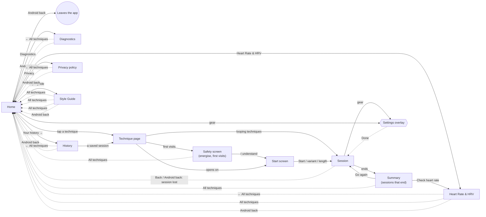

# Navigation map

Generated from the code by `node scripts/nav-map.mjs --write` (#114). Do not edit by hand: change the code, then regenerate. A test fails when this file is out of date.

## Problems

- **dead end** · Diagnostics only leads back to Home.
- **dead end** · Heart Rate & HRV only leads back to Home.
- **dead end** · Privacy policy only leads back to Home.
- **no way back** · Offered from 6 session summaries ("Check heart rate"), but it can only go to Home, not back to the technique.
- **loses a session** · On all 15 technique pages, Back or Android back during a session goes straight to Home with no "stop?" prompt.
- **no ending** · 9 techniques run until you leave: no summary, no "Check heart rate".

## The shape of the app

Home is the only hub. Technique pages follow one of these patterns:

| Technique | Safety screen | Start screen | Ends with a summary |
|---|---|---|---|
| 4-7-8 Breathing (`478-breathing.html`) | · | · | no, runs until you leave |
| Alternate Nostril (`alternate-nostril.html`) | · | yes | no, runs until you leave |
| Bhastrika (`bhastrika.html`) | yes, until acknowledged | yes | yes |
| Bhramari (`bhramari.html`) | · | · | no, runs until you leave |
| Box Breathing (`box-breathing.html`) | · | · | no, runs until you leave |
| Buteyko (`buteyko.html`) | · | yes | yes |
| Connected Breathing (`connected-breathing.html`) | yes, until acknowledged | yes | yes |
| Extended Exhale (`extended-exhale.html`) | · | · | no, runs until you leave |
| Kapalabhati (`kapalabhati.html`) | yes, until acknowledged | yes | yes |
| Physiological Sigh (`physiological-sigh.html`) | · | · | no, runs until you leave |
| Pursed-Lip Breathing (`pursed-lip-breathing.html`) | · | · | no, runs until you leave |
| Resonance Breathing (`resonance-breathing.html`) | · | · | no, runs until you leave |
| Triangle Breathing (`triangle-breathing.html`) | · | · | no, runs until you leave |
| Tummo (`tummo.html`) | yes, until acknowledged | yes | yes |
| Wim Hof Method (`wim-hof.html`) | yes, until acknowledged | yes | yes |

Solid arrows go forward, dotted ones go back or close.

## Every way between screens

| From | Action | To | Kind |
|---|---|---|---|
| Home | Android back | Leaves the app | leave |
| Home | Gear | Home · Settings | overlay |
| Home · Settings | Done / tap outside / Esc | Home | close |
| 4-7-8 Breathing | Opens on | 4-7-8 Breathing · Session | forward |
| 4-7-8 Breathing · Session | Gear | 4-7-8 Breathing · Settings | overlay |
| 4-7-8 Breathing · Settings | Done / tap outside / Esc | 4-7-8 Breathing · Session | close |
| 4-7-8 Breathing · Session | Back (top bar) / Android back | Home | loses |
| Alternate Nostril · Start screen | A variant | Alternate Nostril · Session | forward |
| Alternate Nostril | Opens on | Alternate Nostril · Start screen | forward |
| Alternate Nostril · Session | Gear | Alternate Nostril · Settings | overlay |
| Alternate Nostril · Settings | Done / tap outside / Esc | Alternate Nostril · Session | close |
| Alternate Nostril · Start screen | Back (top bar) / Android back | Home | back |
| Alternate Nostril · Session | Back (top bar) / Android back | Home | loses |
| Bhastrika · Start screen | Start | Bhastrika · Session | forward |
| Bhastrika | Opens on (first visits) | Bhastrika · Safety screen (until "don't show again") | forward |
| Bhastrika · Safety screen (until "don't show again") | I understand, continue | Bhastrika · Start screen | forward |
| Bhastrika · Safety screen (until "don't show again") | All techniques | Home | back |
| Bhastrika | Opens on (once acknowledged) | Bhastrika · Start screen | forward |
| Bhastrika · Session | Session ends | Bhastrika · Summary | forward |
| Bhastrika · Summary | Go again | Bhastrika · Session | forward |
| Bhastrika · Summary | Check heart rate | Heart Rate & HRV | forward |
| Bhastrika · Summary | All techniques | Home | back |
| Bhastrika · Session | Gear | Bhastrika · Settings | overlay |
| Bhastrika · Settings | Done / tap outside / Esc | Bhastrika · Session | close |
| Bhastrika · Start screen | Back (top bar) / Android back | Home | back |
| Bhastrika · Session | Back (top bar) / Android back | Home | loses |
| Bhastrika · Summary | Back (top bar) / Android back | Home | back |
| Bhramari | Opens on | Bhramari · Session | forward |
| Bhramari · Session | Gear | Bhramari · Settings | overlay |
| Bhramari · Settings | Done / tap outside / Esc | Bhramari · Session | close |
| Bhramari · Session | Back (top bar) / Android back | Home | loses |
| Box Breathing | Opens on | Box Breathing · Session | forward |
| Box Breathing · Session | Gear | Box Breathing · Settings | overlay |
| Box Breathing · Settings | Done / tap outside / Esc | Box Breathing · Session | close |
| Box Breathing · Session | Back (top bar) / Android back | Home | loses |
| Buteyko · Start screen | Start | Buteyko · Session | forward |
| Buteyko | Opens on | Buteyko · Start screen | forward |
| Buteyko · Session | Session ends | Buteyko · Summary | forward |
| Buteyko · Summary | Go again | Buteyko · Session | forward |
| Buteyko · Summary | Check heart rate | Heart Rate & HRV | forward |
| Buteyko · Summary | All techniques | Home | back |
| Buteyko · Session | Gear | Buteyko · Settings | overlay |
| Buteyko · Settings | Done / tap outside / Esc | Buteyko · Session | close |
| Buteyko · Start screen | Back (top bar) / Android back | Home | back |
| Buteyko · Session | Back (top bar) / Android back | Home | loses |
| Buteyko · Summary | Back (top bar) / Android back | Home | back |
| Connected Breathing · Start screen | A length | Connected Breathing · Session | forward |
| Connected Breathing | Opens on (first visits) | Connected Breathing · Safety screen (until "don't show again") | forward |
| Connected Breathing · Safety screen (until "don't show again") | I understand, continue | Connected Breathing · Start screen | forward |
| Connected Breathing · Safety screen (until "don't show again") | All techniques | Home | back |
| Connected Breathing | Opens on (once acknowledged) | Connected Breathing · Start screen | forward |
| Connected Breathing · Session | Session ends | Connected Breathing · Summary | forward |
| Connected Breathing · Summary | Go again | Connected Breathing · Session | forward |
| Connected Breathing · Summary | Check heart rate | Heart Rate & HRV | forward |
| Connected Breathing · Summary | All techniques | Home | back |
| Connected Breathing · Session | Gear | Connected Breathing · Settings | overlay |
| Connected Breathing · Settings | Done / tap outside / Esc | Connected Breathing · Session | close |
| Connected Breathing · Start screen | Back (top bar) / Android back | Home | back |
| Connected Breathing · Session | Back (top bar) / Android back | Home | loses |
| Connected Breathing · Summary | Back (top bar) / Android back | Home | back |
| Diagnostics | ← All techniques | Home | back |
| Diagnostics | Android back | Home | back |
| Extended Exhale | Opens on | Extended Exhale · Session | forward |
| Extended Exhale · Session | Gear | Extended Exhale · Settings | overlay |
| Extended Exhale · Settings | Done / tap outside / Esc | Extended Exhale · Session | close |
| Extended Exhale · Session | Back (top bar) / Android back | Home | loses |
| Heart Rate & HRV | ← All techniques | Home | back |
| Heart Rate & HRV | All techniques | Home | back |
| Heart Rate & HRV | Android back | Home | back |
| History | ← All techniques | Home | back |
| History | A saved session (opens its technique) | Its technique page | forward |
| History | Android back | Home | back |
| Home | Heart Rate & HRV | Heart Rate & HRV | forward |
| Home | Buteyko | Buteyko | forward |
| Home | Resonance Breathing | Resonance Breathing | forward |
| Home | 4-7-8 Breathing | 4-7-8 Breathing | forward |
| Home | Extended Exhale | Extended Exhale | forward |
| Home | Physiological Sigh | Physiological Sigh | forward |
| Home | Bhramari · Humming Bee | Bhramari | forward |
| Home | Pursed-Lip Breathing | Pursed-Lip Breathing | forward |
| Home | Box Breathing | Box Breathing | forward |
| Home | Triangle Breathing | Triangle Breathing | forward |
| Home | Alternate Nostril · Nadi Shodhana | Alternate Nostril | forward |
| Home | Bhastrika · Bellows Breath | Bhastrika | forward |
| Home | Kapalabhati · Skull-Shining Breath | Kapalabhati | forward |
| Home | Wim Hof Method | Wim Hof Method | forward |
| Home | Tummo · Inner Fire | Tummo | forward |
| Home | Connected Breathing | Connected Breathing | forward |
| Home | Your history → | History | forward |
| Home | Privacy | Privacy policy | forward |
| Home | Diagnostics | Diagnostics | forward |
| Home | Style guide | Style Guide | forward |
| Kapalabhati · Start screen | Start | Kapalabhati · Session | forward |
| Kapalabhati | Opens on (first visits) | Kapalabhati · Safety screen (until "don't show again") | forward |
| Kapalabhati · Safety screen (until "don't show again") | I understand, continue | Kapalabhati · Start screen | forward |
| Kapalabhati · Safety screen (until "don't show again") | All techniques | Home | back |
| Kapalabhati | Opens on (once acknowledged) | Kapalabhati · Start screen | forward |
| Kapalabhati · Session | Session ends | Kapalabhati · Summary | forward |
| Kapalabhati · Summary | Go again | Kapalabhati · Session | forward |
| Kapalabhati · Summary | Check heart rate | Heart Rate & HRV | forward |
| Kapalabhati · Summary | All techniques | Home | back |
| Kapalabhati · Session | Gear | Kapalabhati · Settings | overlay |
| Kapalabhati · Settings | Done / tap outside / Esc | Kapalabhati · Session | close |
| Kapalabhati · Start screen | Back (top bar) / Android back | Home | back |
| Kapalabhati · Session | Back (top bar) / Android back | Home | loses |
| Kapalabhati · Summary | Back (top bar) / Android back | Home | back |
| Physiological Sigh | Opens on | Physiological Sigh · Session | forward |
| Physiological Sigh · Session | Gear | Physiological Sigh · Settings | overlay |
| Physiological Sigh · Settings | Done / tap outside / Esc | Physiological Sigh · Session | close |
| Physiological Sigh · Session | Back (top bar) / Android back | Home | loses |
| Privacy policy | ← All techniques | Home | back |
| Privacy policy | Android back | Home | back |
| Pursed-Lip Breathing | Opens on | Pursed-Lip Breathing · Session | forward |
| Pursed-Lip Breathing · Session | Gear | Pursed-Lip Breathing · Settings | overlay |
| Pursed-Lip Breathing · Settings | Done / tap outside / Esc | Pursed-Lip Breathing · Session | close |
| Pursed-Lip Breathing · Session | Back (top bar) / Android back | Home | loses |
| Resonance Breathing | Opens on | Resonance Breathing · Session | forward |
| Resonance Breathing · Session | Gear | Resonance Breathing · Settings | overlay |
| Resonance Breathing · Settings | Done / tap outside / Esc | Resonance Breathing · Session | close |
| Resonance Breathing · Session | Back (top bar) / Android back | Home | loses |
| Style Guide | All techniques | Home | back |
| Style Guide | All techniques | Home | back |
| Style Guide | Resonance Breathing | Resonance Breathing | forward |
| Style Guide | All techniques | Home | back |
| Style Guide | Android back | Home | back |
| Triangle Breathing | Opens on | Triangle Breathing · Session | forward |
| Triangle Breathing · Session | Gear | Triangle Breathing · Settings | overlay |
| Triangle Breathing · Settings | Done / tap outside / Esc | Triangle Breathing · Session | close |
| Triangle Breathing · Session | Back (top bar) / Android back | Home | loses |
| Tummo · Start screen | Start | Tummo · Session | forward |
| Tummo | Opens on (first visits) | Tummo · Safety screen (until "don't show again") | forward |
| Tummo · Safety screen (until "don't show again") | I understand, continue | Tummo · Start screen | forward |
| Tummo · Safety screen (until "don't show again") | All techniques | Home | back |
| Tummo | Opens on (once acknowledged) | Tummo · Start screen | forward |
| Tummo · Session | Session ends | Tummo · Summary | forward |
| Tummo · Summary | Go again | Tummo · Session | forward |
| Tummo · Summary | Check heart rate | Heart Rate & HRV | forward |
| Tummo · Summary | All techniques | Home | back |
| Tummo · Session | Gear | Tummo · Settings | overlay |
| Tummo · Settings | Done / tap outside / Esc | Tummo · Session | close |
| Tummo · Start screen | Back (top bar) / Android back | Home | back |
| Tummo · Session | Back (top bar) / Android back | Home | loses |
| Tummo · Summary | Back (top bar) / Android back | Home | back |
| Wim Hof Method · Start screen | Start | Wim Hof Method · Session | forward |
| Wim Hof Method | Opens on (first visits) | Wim Hof Method · Safety screen (until "don't show again") | forward |
| Wim Hof Method · Safety screen (until "don't show again") | I understand, continue | Wim Hof Method · Start screen | forward |
| Wim Hof Method · Safety screen (until "don't show again") | All techniques | Home | back |
| Wim Hof Method | Opens on (once acknowledged) | Wim Hof Method · Start screen | forward |
| Wim Hof Method · Session | Session ends | Wim Hof Method · Summary | forward |
| Wim Hof Method · Summary | Go again | Wim Hof Method · Session | forward |
| Wim Hof Method · Summary | Check heart rate | Heart Rate & HRV | forward |
| Wim Hof Method · Summary | All techniques | Home | back |
| Wim Hof Method · Session | Gear | Wim Hof Method · Settings | overlay |
| Wim Hof Method · Settings | Done / tap outside / Esc | Wim Hof Method · Session | close |
| Wim Hof Method · Start screen | Back (top bar) / Android back | Home | back |
| Wim Hof Method · Session | Back (top bar) / Android back | Home | loses |
| Wim Hof Method · Summary | Back (top bar) / Android back | Home | back |
